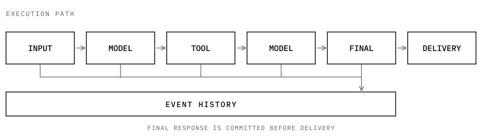

<picture>
  <source media="(prefers-color-scheme: dark)" srcset="https://raw.githubusercontent.com/12bitsD/nextloop/main/docs/assets/wordmark-dark.svg">
  <source media="(prefers-color-scheme: light)" srcset="https://raw.githubusercontent.com/12bitsD/nextloop/main/docs/assets/wordmark-light.svg">
  
</picture>

  
  
  
  

  <a href="docs/tutorial.md">Tutorial</a> ·
  <a href="docs/design/harness.md">Configuration</a> ·
  <a href="docs/design/loop-interface.md">API</a> ·
  <a href="docs/design/guarantees.md">Guarantees</a> ·
  <a href="CONTRIBUTING.md">Contributing</a> ·
  <a href="README.zh-CN.md">中文版</a>

nextloop is a Python library for building agent applications. It coordinates model calls and tool execution, and records what happens during each run.

These records let you inspect a run and recover after a process crash. During recovery, nextloop does not automatically run a dispatched tool again.

Your application provides the model, tools, storage, and delivery method.

  <picture>
    <source media="(max-width: 600px) and (prefers-color-scheme: dark)" srcset="https://raw.githubusercontent.com/12bitsD/nextloop/main/docs/assets/steps-compact-dark.svg">
    <source media="(max-width: 600px) and (prefers-color-scheme: light)" srcset="https://raw.githubusercontent.com/12bitsD/nextloop/main/docs/assets/steps-compact-light.svg">
    <source media="(prefers-color-scheme: dark)" srcset="https://raw.githubusercontent.com/12bitsD/nextloop/main/docs/assets/steps-dark.svg">
    <source media="(prefers-color-scheme: light)" srcset="https://raw.githubusercontent.com/12bitsD/nextloop/main/docs/assets/steps-light.svg">
    
  </picture>

## Quickstart

<table role="presentation">
  <tr>
    <td width="50%" valign="top">
      <strong>01 / Install</strong> 
      Python 3.11 or later is required.
      <pre><code>python -m pip install nextloop</code></pre>
    </td>
    <td width="50%" valign="top">
      <strong>02 / Run the example</strong> 
      Run from a source checkout. No API key is needed.
      <pre><code>python examples/basic.py</code></pre>
    </td>
  </tr>
</table>

The example calls a Tool and prints `hello from nextloop`.

Follow [Your first AgentLoop](docs/tutorial.md) to build the same flow yourself. The tutorial also shows how to connect a hosted model.

## What nextloop provides

<table role="presentation">
  <tr>
    <td width="50%" valign="top">
      
       
      <strong>Execution history</strong> 
      Record model calls, tool calls, results, and final responses. Query history or export traces.
    </td>
    <td width="50%" valign="top">
      
       
      <strong>Crash recovery</strong> 
      See completed and uncertain operations. Redeliver committed responses without rerunning the model or tools.
    </td>
  </tr>
  <tr>
    <td width="50%" valign="top">
      
       
      <strong>Tool and model integration</strong> 
      Use Python, MCP, Rust, or C++ tools. OpenAI-compatible and Anthropic providers are included. Custom adapters are supported.
    </td>
    <td width="50%" valign="top">
      
       
      <strong>Execution limits</strong> 
      Limit steps, model calls, tool calls, tokens, and running time.
    </td>
  </tr>
  <tr>
    <td width="50%" valign="top">
      
       
      <strong>Large tool results</strong> 
      Show previews or pages to the model. Keep full results available for later reads.
    </td>
    <td width="50%" valign="top">
      
       
      <strong>Streaming previews</strong> 
      Stream output without executing partial tool calls, changing event history, or replacing the final response.
    </td>
  </tr>
</table>

nextloop is a library, not an HTTP service or a multi-agent framework. Your application controls when to run, deliver, and recover work. `Harness` gives you one place to perform these operations. The Event log is the source of truth.

## Direction

Keep the core small and easy to understand. Use a few clear concepts and keep optional capabilities in adapters and outer layers.

### Reliable execution

Make long-running and concurrent work easier to recover and reason about. Improve the runtime when real use and test evidence show a need.

### Composable capabilities

Let applications add long-term Memory, evaluation, and Recursive Self-Improvement (RSI) through small public interfaces. Applications own Memory policy, experiment strategy, scoring, and product decisions.

### Open observability

Let applications connect OpenTelemetry, Langfuse, and other systems through Adapters. Adapters own vendor-specific features and dependencies.

### Tools in more languages

Make Tools easier to write in languages such as Go and Rust through the existing Worker model. Share one AgentLoop core across languages.

### Stable core, independent extensions

Keep the public API and Event history coherent while extensions evolve independently. Let real consumer needs guide new core interfaces. Release verified improvements.

## Documentation

Start with the [documentation index](docs/README.md) for current contracts, design decisions, historical plans, and research evidence.

<table role="presentation">
  <tr>
    <td width="30%" valign="top">
      <strong>Get started</strong> 
      <a href="docs/tutorial.md">Your first AgentLoop</a> 
      <a href="docs/design/harness.md">Harness configuration</a> 
      <a href="docs/design/loop-interface.md">Public API and adapters</a>
    </td>
    <td width="40%" valign="top">
      <strong>Understand the runtime</strong> 
      <a href="docs/design/architecture.md">Architecture</a> 
      <a href="docs/design/agent-loop.md">AgentLoop design</a> 
      <a href="docs/design/guarantees.md">Guarantees</a> 
      <a href="CONTEXT.md">Domain glossary</a> 
      <a href="docs/adr/">Design decisions</a>
    </td>
    <td width="30%" valign="top">
      <strong>Verify and develop</strong> 
      <a href="docs/design/verification-matrix.md">Verification matrix</a> 
      <a href="CONTRIBUTING.md">Contributing</a> 
      <a href="CHANGELOG.md">Changelog</a> 
      <a href="SECURITY.md">Security</a>
    </td>
  </tr>
</table>

## Release and security

<table role="presentation">
  <tr>
    <td valign="top">
      
       
      <strong>Python support</strong> 
      CI covers Python 3.11, 3.12, 3.13, and 3.14.
    </td>
  </tr>
  <tr>
    <td valign="top">
      
       
      <strong>Tagged releases</strong> 
      A <code>v*</code> tag verifies the package and benchmark, publishes wheel and sdist to PyPI through Trusted Publishing, and creates a GitHub Release.
    </td>
  </tr>
  <tr>
    <td valign="top">
      
       
      <strong>Public repository</strong> 
      Do not commit credentials, private trajectories, internal endpoints, or personal data.
    </td>
  </tr>
</table>
