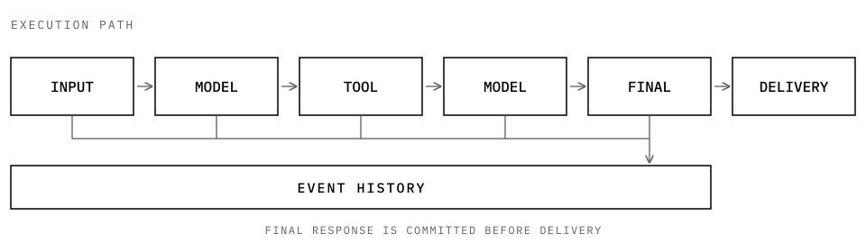

<picture>
  <source media="(prefers-color-scheme: dark)" srcset="https://raw.githubusercontent.com/12bitsD/nextloop/main/docs/assets/wordmark-dark.svg">
  <source media="(prefers-color-scheme: light)" srcset="https://raw.githubusercontent.com/12bitsD/nextloop/main/docs/assets/wordmark-light.svg">
  
</picture>

  
  
  
  

  <a href="docs/tutorial.md">使用教程</a> ·
  <a href="docs/design/harness.md">配置说明</a> ·
  <a href="docs/design/loop-interface.md">公共 API</a> ·
  <a href="docs/design/guarantees.md">能力边界</a> ·
  <a href="CONTRIBUTING.md">参与开发</a> ·
  <a href="README.md">English</a>

nextloop 是一个用于构建 Agent 应用的 Python 库。它负责协调模型调用和 Tool 执行，并记录每次运行的过程。

你可以通过这些记录检查运行过程，并在进程崩溃后恢复。恢复时，nextloop 不会自动重新执行已经派发过的 Tool。

模型、Tool、存储和最终结果的投递方式由你的应用提供。

  <picture>
    <source media="(max-width: 600px) and (prefers-color-scheme: dark)" srcset="https://raw.githubusercontent.com/12bitsD/nextloop/main/docs/assets/steps-compact-dark.svg">
    <source media="(max-width: 600px) and (prefers-color-scheme: light)" srcset="https://raw.githubusercontent.com/12bitsD/nextloop/main/docs/assets/steps-compact-light.svg">
    <source media="(prefers-color-scheme: dark)" srcset="https://raw.githubusercontent.com/12bitsD/nextloop/main/docs/assets/steps-dark.svg">
    <source media="(prefers-color-scheme: light)" srcset="https://raw.githubusercontent.com/12bitsD/nextloop/main/docs/assets/steps-light.svg">
    
  </picture>

## 快速开始

<table role="presentation">
  <tr>
    <td width="50%" valign="top">
      <strong>01 / 安装</strong> 
      需要 Python 3.11 或更高版本。
      <pre><code>python -m pip install nextloop</code></pre>
    </td>
    <td width="50%" valign="top">
      <strong>02 / 运行示例</strong> 
      在源码目录中运行，不需要 API key。
      <pre><code>python examples/basic.py</code></pre>
    </td>
  </tr>
</table>

示例会调用一个 Tool，并输出 `hello from nextloop`。

按照[第一个 AgentLoop 教程](docs/tutorial.md)，你可以自己实现同样的流程，并学习如何接入托管模型。

## 主要功能

<table role="presentation">
  <tr>
    <td width="50%" valign="top">
      
       
      <strong>执行历史</strong> 
      记录模型调用、Tool 调用、执行结果和最终回复。支持查询历史和导出 Trace。
    </td>
    <td width="50%" valign="top">
      
       
      <strong>崩溃恢复</strong> 
      查看已完成和结果不确定的操作。重新投递已提交的最终回复，无需重新运行模型或 Tool。
    </td>
  </tr>
  <tr>
    <td width="50%" valign="top">
      
       
      <strong>Tool 与模型接入</strong> 
      支持 Python、MCP、Rust 和 C++ Tool，内置 OpenAI 兼容及 Anthropic Provider，也支持自定义 Adapter。
    </td>
    <td width="50%" valign="top">
      
       
      <strong>执行限制</strong> 
      限制 Step 数、模型调用次数、Tool 调用次数、Token 用量和运行时间。
    </td>
  </tr>
  <tr>
    <td width="50%" valign="top">
      
       
      <strong>大结果读取</strong> 
      向模型展示预览或分页内容，同时保留完整结果供后续读取。
    </td>
    <td width="50%" valign="top">
      
       
      <strong>流式预览</strong> 
      流式查看输出，不执行未完成的 Tool 调用，不改变事件历史，也不替代最终回复。
    </td>
  </tr>
</table>

nextloop 是一个 Python 库，不是 HTTP 服务或多 Agent 框架。你的应用决定何时运行、投递和恢复工作。`Harness` 提供统一的操作入口，Event 日志是唯一事实来源。

## 发展方向

保持核心简单、容易理解。只保留少量清晰的概念，将可选能力放在 Adapter 和外层扩展中。

### 可靠的执行

让长程和并发任务更容易恢复，也更容易理解运行状态。根据真实需求和测试证据改进运行时。

### 可组合的能力

应用可以通过小型公共接口接入长期 Memory、评估和递归自我改进（RSI）。Memory 策略、实验策略、评分和产品决策由应用负责。

### 开放的可观测性

应用可以通过 Adapter 接入 OpenTelemetry、Langfuse 和其他观测系统。平台特性和依赖由各自的 Adapter 负责。

### 多语言 Tool

通过现有 Worker 模型，让 Go、Rust 等语言更容易编写 Tool。不同语言共用一个 AgentLoop 核心。

### 稳定的核心，独立的扩展

保持公共 API 和 Event 历史一致，同时让扩展独立演进。根据真实使用需求增加核心接口，发布经过验证的改进。

## 文档

从[文档索引](docs/README.md)开始，查找当前使用说明、设计决策、历史规划和研究证据。

<table role="presentation">
  <tr>
    <td width="30%" valign="top">
      <strong>快速上手</strong> 
      <a href="docs/tutorial.md">第一个 AgentLoop</a> 
      <a href="docs/design/harness.md">Harness 配置</a> 
      <a href="docs/design/loop-interface.md">公共 API 与 Adapter</a>
    </td>
    <td width="40%" valign="top">
      <strong>理解运行时</strong> 
      <a href="docs/design/architecture.md">整体架构</a> 
      <a href="docs/design/agent-loop.md">AgentLoop 设计</a> 
      <a href="docs/design/guarantees.md">能力边界</a> 
      <a href="CONTEXT.md">领域术语</a> 
      <a href="docs/adr/">设计决策</a>
    </td>
    <td width="30%" valign="top">
      <strong>验证与开发</strong> 
      <a href="docs/design/verification-matrix.md">验证矩阵</a> 
      <a href="CONTRIBUTING.md">参与开发</a> 
      <a href="CHANGELOG.md">变更日志</a> 
      <a href="SECURITY.md">安全说明</a>
    </td>
  </tr>
</table>

## 发布与安全

<table role="presentation">
  <tr>
    <td valign="top">
      
       
      <strong>Python 支持</strong> 
      CI 覆盖 Python 3.11、3.12、3.13 和 3.14。
    </td>
  </tr>
  <tr>
    <td valign="top">
      
       
      <strong>版本发布</strong> 
      创建 <code>v*</code> tag 后，CI 会验证包和基准，通过 Trusted Publishing 将 wheel 和 sdist 发布到 PyPI，并创建 GitHub Release。
    </td>
  </tr>
  <tr>
    <td valign="top">
      
       
      <strong>公开仓库</strong> 
      请勿提交凭据、私有执行轨迹、内部端点或个人数据。
    </td>
  </tr>
</table>
