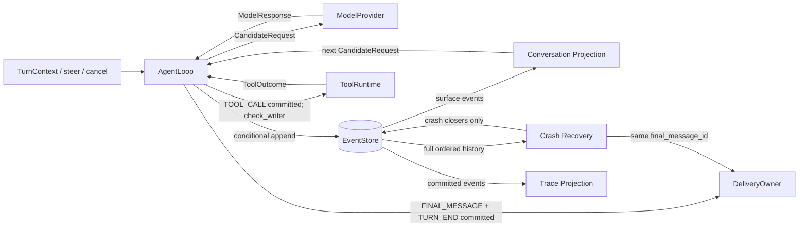

# Architecture and import contract

Status: accepted for 0.5.0.

## Execution path



The Loop coordinates execution; the Store owns ordering and writer fencing. `events/` contains pure folds and projections. Providers, Tools, Delivery, and persistence are adapters. Preview events are transient and do not enter the EventStore.

## Invariants

- Event append checks `writer_epoch` and `expected_seq` atomically. Repeating an append with identical event IDs is idempotent; changing their content is rejected.
- TOOL_CALL is committed before Tool dispatch. A second `check_writer()` runs after that commit and immediately before `ToolRuntime.execute()`.
- Recovery does not replay a dispatched Tool. Missing results become explicit skipped or uncertain outcomes.
- FINAL_MESSAGE and TURN_END are durable before Delivery. Delivery is at least once and owners deduplicate by `final_message_id`.
- Pending Input is derived from INPUT_ACCEPTED and USER_MESSAGE by `input_id`. A later Step boundary commits its consumption; the in-memory inbox is only a wake-up signal.
- Trace records are projections of committed Events. Export failures cannot change Turn outcomes.

Writer epochs currently fence stale writers; they are not time-based leases. Multi-process coordination, persistent Outbox, and Session deletion are separate later milestones.

## Complexity boundaries

Conversation projection makes one pass over the surface returned by the Store and serializes the resulting messages. Its cost scales with returned events and message bytes, not with events hidden before the latest Compaction watermark.

Pending Input requires an ordered log scan. A new Turn currently performs that scan once; it is not an O(1) operation. Trace replay is linear in processed events and payload size. Incremental and whole-history Trace projection use the same fold.

Run the 10,505-event parity benchmark with:

```bash
.venv/bin/python tests/projection_benchmark.py
```

The benchmark checks Memory/SQLite Conversation Projection parity, Model/Tool Trace payload parity, and incremental/whole-history Trace parity. Explicit canaries require the Compaction summary, assistant output, Tool arguments/results, and final content to survive projection; identical erased outputs do not pass. Timings are measurements, not a cross-machine latency guarantee.

## Frozen import contract

The root `nextloop` package keeps its existing convenience re-exports. `tests/test_import_contract.py` snapshots all 94 names and rejects accidental additions, removals, and duplicate entries.

Core integration paths:

- `nextloop.contracts`: public DTOs, errors, enums, and adapter Protocols.
- `nextloop.loop`: `AgentLoop`.
- `nextloop.events`: pure Conversation, response/outcome, recovery, and Trace folds.

Optional implementation and integration paths:

- `nextloop.adapters`: Memory, SQLite, OpenAI-compatible, Anthropic, and observing Stores.
- `nextloop.execute`: built-in Tool execution and runtime implementations.
- `nextloop.harness`: TOML assembly and dependency ownership.
- `nextloop.skills`: directory-backed Skill discovery and loading.
- `nextloop.testing`: Store conformance, deliberately broken Stores, and fault-injection adapters.

No physical `nextloop.core` or `nextloop.extras` package is introduced. A future package split must preserve these paths and root re-exports through compatibility shims. Modules outside this contract, including `driver.py`, `_sse.py`, and stdio transport internals, may change without being treated as stable integration paths.
