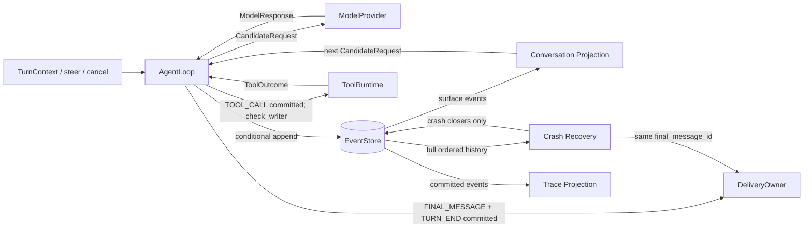

# Architecture and import contract

Status: accepted for 0.5.0.

## Execution path



`AgentLoop` coordinates the work. `EventStore` orders Events and checks which writer may append them. Providers, Tools, Delivery, and storage connect through adapters. Pure functions in `events/` build Conversation and Trace views from the Event log. Preview output is temporary and never enters that log.

## Rules the runtime must preserve

- Every append checks `writer_epoch` and `expected_seq` together. If an owner lease is configured, the same transaction also checks the owner and expiry. Stores without an owner keep the legacy behavior.
- A `TOOL_CALL` is committed before a Tool runs. `check_writer()` runs again immediately before `ToolRuntime.execute()`.
- Recovery never replays a dispatched Tool. A missing result becomes an explicit skipped or uncertain outcome.
- `FINAL_MESSAGE` and `TURN_END` are committed before Delivery. Delivery may happen more than once, so owners deduplicate by `final_message_id`.
- Pending Input comes from `INPUT_ACCEPTED` and `USER_MESSAGE` Events with the same `input_id`. A later Step boundary records its consumption. The in-memory inbox only wakes the Loop.
- Traces are derived from committed Events. An export failure cannot change a Turn result.

### Ownership, export, and deletion

Owner leases are optional. The same owner can take over after a restart. A different owner must wait for expiry or use an explicit force. Heartbeats renew leases independently of Event appends, and the Store clock decides expiry. SQLite supports same-host process contention, not distributed coordination.

`SQLiteOutbox` lets callers export Traces durably. Whole-Session deletion uses tombstones to block further access, removes local Trace/Outbox state, and purges SQLite bytes. It does not delete third-party exports or external assets.

## Performance boundaries

- Conversation Projection loads the current Surface once per Turn and folds new facts for each Model request. Rejected batches, approval anchors, Pending Inputs, and WorkingContext are collected before messages are built.
- Appending to the Surface does not repeatedly copy the Event tuple. Compaction snapshots the committed Surface before waiting for a summary, so new steering cannot change its source range.
- Pending Input requires an ordered log scan once per Turn; it is not an O(1) lookup.
- Canonical bytes are cached for each immutable `CandidateRequest`. The Memory Store indexes Event IDs without copying the full ID set on every append.
- Trace replay is linear in the number of Events and their payload size. Incremental and whole-history Trace Projection use the same fold.
- An experimental message cache was not retained because its 100-Step improvement did not reach the required 50% on both Store backends.

Run the 10,505-event parity benchmark:

```bash
.venv/bin/python tests/projection_benchmark.py
```

It checks that Memory and SQLite produce the same Conversation and Model/Tool Trace data, and that incremental and whole-history Traces match. Canary content verifies that summaries, assistant output, Tool arguments and results, and final content survive Projection. `tests/turn_projection_benchmark.py` measures complete 100/400-Step Turns on both Stores. These timings describe the test environment, not a latency guarantee for other machines.

## Import contract

The root `nextloop` package keeps its convenience re-exports. `tests/test_import_contract.py` snapshots all 101 names and rejects accidental changes or duplicates.

Stable integration paths:

- `nextloop.contracts`: public data types, errors, enums, and adapter Protocols.
- `nextloop.loop`: `AgentLoop`.
- `nextloop.events`: pure Conversation, response, outcome, recovery, and Trace functions.
- `nextloop.adapters`: Memory, SQLite, OpenAI-compatible, Anthropic, and observing Stores.
- `nextloop.execute`: built-in Tool execution and runtime implementations.
- `nextloop.harness`: TOML setup and dependency ownership.
- `nextloop.skills`: directory-backed Skill discovery and loading.
- `nextloop.testing`: Store conformance, broken Stores, and fault injection.

There is no physical `nextloop.core` or `nextloop.extras` package. A future package split must preserve these paths and the root re-exports through compatibility shims. Internal modules such as `driver.py`, `_sse.py`, and stdio transport internals may change without becoming stable integration paths.
